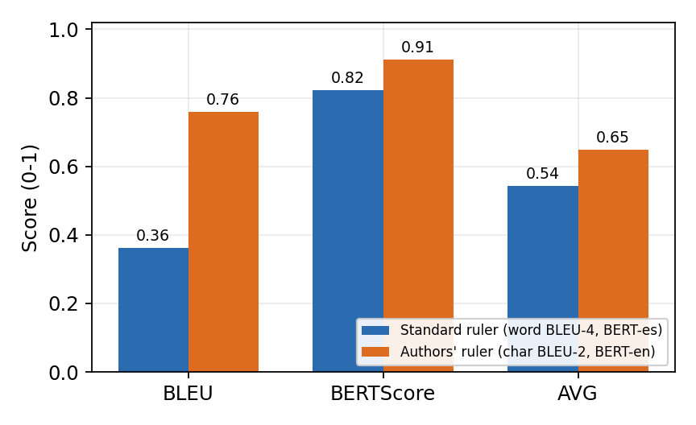
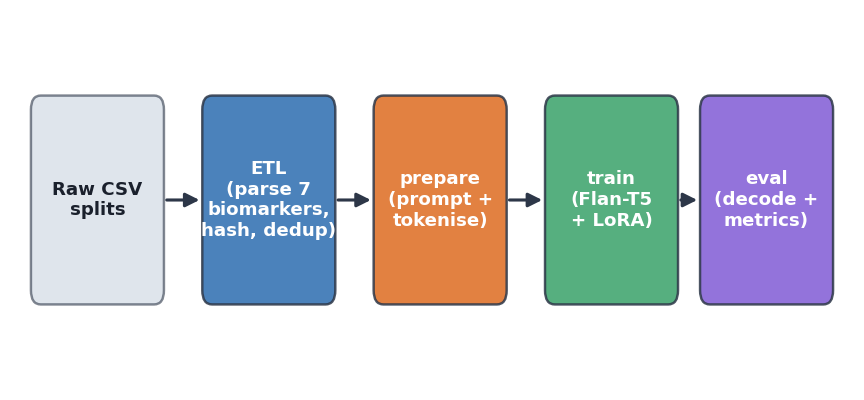

# Acoustic-Driven Generation of mFDA Speech Reports

Fine-tuning **Flan-T5** to write clinical speech reports in the style of the modified Frenchay
Dysarthria Assessment (**mFDA**) from seven numeric **acoustic biomarkers**. This repository
reproduces and extends Arias-Vergara et al. (2025), *"Acoustic-Driven Generation of Pathological
Speech Reports Using Large Language Models"*, and studies how comparable the evaluation metrics
are across the two works.


---

## Highlights

- **Best model (B17):** `google/flan-t5-base` (248M parameters): a 5-epoch full fine-tune,
  then 3 epochs of **rank-32 LoRA** (adapters merged).
- **Close to the paper's 7B systems:** with the paper's own evaluation, B17 scores
  **AVG 0.649** (char-BLEU 0.759, BERTScore 0.911). The paper's best 7B models score about 0.68,
  and B17 is **28× smaller**.
- **Main finding: most of the gap was in the metric, not the model.** The paper reports
  *character-level* BLEU-2, while standard practice is *word-level* BLEU-4. On the same outputs,
  BLEU is **0.76** (character-level) vs **0.36** (word-level).
- **Reproducible pipeline:** ETL → prepare → train → evaluate, with more than 20 controlled
  experiments that map where Flan-T5-base stops improving.

## The task

The input is seven acoustic biomarkers, one per mFDA category. The output is a free-text report
that gives a severity and a clinical description for each category.

**Input** (encoder prompt, `flan-paper` style)

```text
Generate a report for: Breathing: 51 Lips: 1.3 Palate: 0.51 Larynx: 0.64 Monotonicity: 0.033 Tongue: 0.031 Intelligibility: 0.3
```

**Output** (a synthetic training target)

```text
Breathing (Severe): control over respiration is grossly distorted. Lips (Moderate): the sounds
produced with the lips are auditorily weak. Palate (Severe): speech quality is extremely
deteriorated. Larynx (Moderate): Problems to maintain a proper intonation and loudness control.
Monotonicity (Moderate): there are problems to vary intonation and/or pace during a conversation.
Tongue (Severe): severe tongue control. Intelligibility (Severe): speech is incomprehensible.
```

| mFDA category | Acoustic feature |
| --- | --- |
| Breathing | `DDK_Consonants_nPVI` |
| Lips | `DDK_voiceless_LLR_Post` |
| Palate | `DDK_velar_Max_Post` |
| Larynx | `Vowel-APQ-11` |
| Monotonicity | `Mono_stop_Avg_dur` |
| Tongue | `DDK_alveolar_Std_dur` |
| Intelligibility | `Text_voiceless_Max_Post` |

**Data.** The real cohort has only 50 Parkinson's disease (PD) patients and 50 healthy controls
(HC) from the PC-GITA corpus, which is too few to train a generator. Following the reference
paper, the models are trained on up to **100k synthetic** biomarker→report pairs, sampled from the
distribution of the real features and balanced across severity bands. They are tested on **96
real** clinical reports (48 PD, 48 HC) that were never used in training.

## Results

B17 on the 96 real test reports:

| Evaluation | R-1 | R-2 | R-L | BLEU | BERTScore | **AVG** |
| --- | --- | --- | --- | --- | --- | --- |
| Standard: word BLEU-4, beam search (`main.eval_decode`) | 0.605 | 0.389 | 0.530 | 0.362 | 0.911 | **0.559** |
| Paper-parity: char BLEU-2, sampling (`main.eval_author_parity`) | 0.632 | 0.394 | 0.548 | 0.759 | 0.911 | **0.649** |
| *Reference paper, best 7B models (LLaMA / Mistral / DeepSeek)* | | | | *0.789 PD / 0.836 HC* | | *~0.68* |

<p align="center">
  
  <br>
  <em>The same B17 outputs scored two ways. BLEU roughly doubles under the paper's
  character-level definition. The left bars use the earlier <code>lang=es</code> BERTScore setting,
  later corrected to <code>en</code>, which raises BERTScore to 0.911.</em>
</p>

**Why the two evaluations differ**

1. **The BLEU definition.** The reference code passes raw strings to `nltk.sentence_bleu`, which
   then splits them into *characters*. Any two English clinical reports share an alphabet and a
   lot of boilerplate, so they already score about 0.6–0.84 on this measure.
2. **The BERTScore language.** The speech recordings are Colombian Spanish, but the reports are
   written in **English**. Scoring them with `lang=es` lowered BERTScore by about 0.09.
3. **A cross-check:** ROUGE-2 is almost the same under both evaluations (0.389 vs 0.394), because
   ROUGE counts words in both. The whole difference comes from BLEU.

> Use the **standard** AVG from `main.eval_decode` to choose between models. Use the
> paper-parity numbers only to compare against the reference paper. In this project, training
> loss and generation quality have repeatedly disagreed, so `test_loss` is not a reliable way to
> pick a model.

### Settings tried that did not beat B17

| Setting | Outcome (standard AVG) |
| --- | --- |
| Learning rate | 5e-4 is far better than 3e-4 (0.522 vs 0.395) |
| Epochs 3 → 5 | 0.529 → 0.538 |
| LoRA rank 8 / 16 / 32 | 0.538 / 0.540 / **0.542** |
| Weight decay 0.0 / 0.05 | 0.500 / 0.517 (0.01 is best) |
| Label smoothing | Output collapses (~0.18) |
| Flan-T5-large | 0.536: same as base at 3× the cost |
| Non-Flan `t5-base` | 0.439: instruction tuning (Flan) matters |
| Structured / label-only targets | 0.315 – 0.531 |
| Raw `Instructions` string as input | 0.479: the compact seven-score input works better |

*These AVG values were logged with the earlier `lang=es` BERTScore setting. They are comparable
with each other but not with the corrected 0.559 above.*

**Known limitation:** PD reports are harder to generate than HC reports (standard AVG 0.532 vs
0.586). The full experiment log is in [docs/training_progress.md](docs/training_progress.md).

## Pipeline

<p align="center">
  
</p>

| Stage | Entry point | What it does |
| --- | --- | --- |
| ETL | `etl/run_etl.py` | Parses the 7 biomarkers from raw CSVs, builds the input and target text, hashes, removes duplicates, and checks for leakage across splits |
| Prepare | `python -m main.prepare` | Applies a prompt style and tokenizes into a Hugging Face `DatasetDict` |
| Train | `python -m main.train` | `Seq2SeqTrainer` with full fine-tuning, LoRA, or a frozen encoder, plus optional severity oversampling |
| Evaluate | `python -m main.eval_decode` | Beam-search decoding with ROUGE, SacreBLEU, and BERTScore, overall and split by PD/HC |
| | `python -m main.eval_author_parity` | Re-runs the reference paper's decoding and metrics exactly |
| | `python -m main.eval_structured` | Scores severity-label accuracy separately from prose quality, for structured targets |

All stages use the same parsing code (`etl/etl_lib.py`), so raw strings are parsed in only one
place.

## Getting started

### 1. Environment

```bash
conda create -n AcousticDrivenGeneration python=3.11
conda activate AcousticDrivenGeneration
# Install PyTorch for your CUDA/CPU build first: https://pytorch.org
pip install -r requirements.txt
```

`requirements.txt` does not pin PyTorch, so that you can install the build that matches your
hardware.

### 2. Data

**The dataset is not included in this repository.** The real reports come from the PC-GITA
corpus, and the synthetic splits were provided by the reference study's authors. Place the CSVs
here:

```text
data/Data_splits/
├── 1k_samples_balanced/train_split.csv     # ID, Instructions, Report
├── 10k_samples_balanced/train_split.csv
├── 100k_samples_balanced/train_split.csv
├── val_split.csv
└── test_split.csv                          # ID, Group (PD/HC), Instructions, Report
```

### 3. Reproduce B17

```bash
# Prepare: tokenize the 100k split with the flan-paper prompt
python -m main.prepare --train-size 100k --prompt-style flan-paper \
  --output-dir data/processed/flan-t5-base/100k-flan-paper \
  --tokenize --tokenizer-model google/flan-t5-base

# Stage 1 (B11): full fine-tune, 5 epochs
python -m main.train \
  --tokenized-dir data/processed/flan-t5-base/100k-flan-paper/tokenized \
  --output-dir runs/flan-t5-base/100k-flan-paper-5ep \
  --model-name google/flan-t5-base \
  --num-train-epochs 5 --learning-rate 5e-4 --weight-decay 0.01 --warmup-ratio 0.1 \
  --per-device-train-batch-size 4 --seed 42 --require-gpu

# Stage 2 (B17): LoRA rank 32 on top of B11, 3 epochs (adapters merged into final_model/)
python -m main.train \
  --tokenized-dir data/processed/flan-t5-base/100k-flan-paper/tokenized \
  --output-dir runs/flan-t5-base/100k-flan-paper-5ep-lora32 \
  --model-name runs/flan-t5-base/100k-flan-paper-5ep/final_model \
  --lora-rank 32 --num-train-epochs 3 --learning-rate 5e-4 --weight-decay 0.01 \
  --warmup-ratio 0.1 --per-device-train-batch-size 4 --seed 42 --require-gpu

# Evaluate: standard metrics (use these for model selection)
python -m main.eval_decode \
  --tokenized-dir data/processed/flan-t5-base/100k-flan-paper/tokenized \
  --model-path runs/flan-t5-base/100k-flan-paper-5ep-lora32/final_model \
  --tokenizer-model google/flan-t5-base \
  --output-json runs/flan-t5-base/100k-flan-paper-5ep-lora32/test_decode_metrics.json \
  --require-gpu

# Evaluate: the reference paper's metrics (for comparison with the paper)
python -m main.eval_author_parity \
  --tokenized-dir data/processed/flan-t5-base/100k-flan-paper/tokenized \
  --model-path runs/flan-t5-base/100k-flan-paper-5ep-lora32/final_model \
  --tokenizer-model google/flan-t5-base \
  --output-json runs/flan-t5-base/100k-flan-paper-5ep-lora32/test_author_parity_metrics.json \
  --require-gpu
```

Decoding needs a GPU; on CPU it takes too long to be practical. The experiments were run on
A100s on the NHR@FAU TinyGPU cluster. The Slurm scripts for every experiment are in
[scripts/hpc/](scripts/hpc/), and the cluster setup is described in
[docs/hpc-commands.md](docs/hpc-commands.md).

### Tests

```bash
python -m pytest test/
```

## Repository layout

```text
etl/            Shared parsing core (etl_lib.py), batch ETL, and data-quality reports
main/           prepare, train, the eval_* scripts, prompt styles, structured-report tools, analysis
scripts/hpc/    Slurm job scripts, named by experiment ID (B11, B17, L5, ...)
runs/           Metric JSONs and plots per run (model weights are not committed)
report/         Final project report (PDF + LaTeX source) and figures
docs/           Pipeline guides, training recipe, experiment log, paper notes
analysis/       Audit comparing synthetic and real report distributions
Speech_LLM/     Reference training/evaluation scripts from the original study, used for parity checks
test/           Unit tests
```

## Documentation

| Document | Contents |
| --- | --- |
| [report/AcousticDrivenGeneration_Report.pdf](report/AcousticDrivenGeneration_Report.pdf) | Full final report |
| [docs/B17-final-summary.md](docs/B17-final-summary.md) | Final model results and interpretation |
| [docs/data-pipeline.md](docs/data-pipeline.md) | `main.prepare` flags and prompt styles |
| [docs/train.md](docs/train.md) | Training recipe, current best runs, and settings already ruled out |
| [docs/eval-decode.md](docs/eval-decode.md) | Decoding and metric options |
| [docs/training_progress.md](docs/training_progress.md) | Log of all experiments |
| [etl/README.md](etl/README.md) | ETL details |

## Acknowledgements and references

- T. Arias-Vergara et al., *Acoustic-Driven Generation of Pathological Speech Reports Using Large
  Language Models*, preprint, 2025. DOI: [10.21203/rs.3.rs-7326708/v1](https://doi.org/10.21203/rs.3.rs-7326708/v1)
- J. R. Orozco-Arroyave et al., *New Spanish Speech Corpus Database for the Analysis of People
  Suffering from Parkinson's Disease (PC-GITA)*, LREC 2014.
- H. W. Chung et al., *Scaling Instruction-Finetuned Language Models* (Flan-T5), 2022.
- E. J. Hu et al., *LoRA: Low-Rank Adaptation of Large Language Models*, 2021.

This project was carried out at Friedrich-Alexander-Universität Erlangen-Nürnberg (FAU), using
compute from NHR@FAU.

> **Disclaimer:** This is a research project. The generated reports are not validated for
> clinical use.
